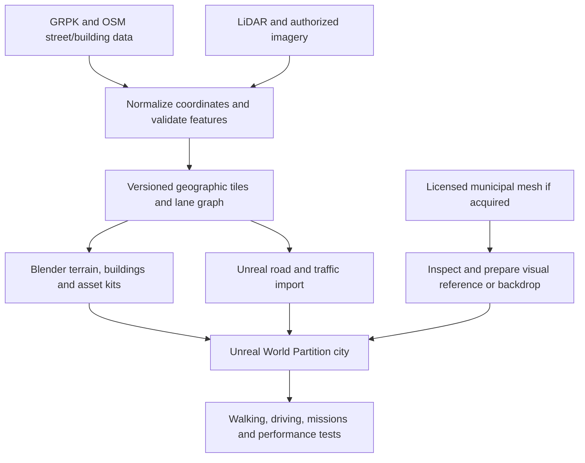

**Game foundation and delivery plan**

Recommendation dated 13 October 2026. Assumptions: single-player Windows PC first, a present-day city, and an experienced small team. Multiplayer from the beginning would change the implementation order and require early replication and vehicle-networking tests.

**Choose this stack**

| Layer | Choice | Reason and boundary |
| --- | --- | --- |
| Engine | Unreal Engine 5.8.3 | Verified released hotfix. Pin it for the first slice and verify every chosen plugin in a packaged build |
| Gameplay | C++ core with Blueprint content | Put persistent state, interfaces, import code, and expensive simulation in C++; use Blueprints for mission authoring and tuning |
| Starting project | Third Person C++ project plus Open World level | Small enough to understand; add the systems the slice needs |
| Asset authoring | Blender 4.5 LTS, initially 4.5.14 | Conservative supported baseline; validate addon and exporter compatibility before upgrading |
| Geographic processing | QGIS, GDAL, PDAL, Python, pyproj, Shapely, Osmium | Inspect, transform, clip, process point clouds, and generate reproducible tile inputs |
| Working data | GeoPackage, GeoTIFF, LAZ, OSM PBF, JSON manifests | Portable local pipeline; add PostGIS only when concurrent editing or data volume warrants it |
| World | World Partition, One File Per Actor, Data Layers, HLOD | Stream local content and keep authors' edits manageable |
| Roads | A project-owned road and junction generator | Real centerlines plus checked lane geometry, bridge profiles, sidewalks, and traffic connections |
| Procedural dressing | Blender Geometry Nodes and Unreal PCG | Repeat facade modules and place props inside geographic masks; bake predictable content for the slice |
| Vehicles | Chaos Vehicles, one car first | Tune suspension, tires, steering, weight transfer, camera, and feedback together |
| Character | Character Movement first; selected Game Animation Sample systems next | Establish working controls and vehicle transitions before animation complexity |
| AI | Small lane-graph traffic controller first; evaluate Mass/ZoneGraph for scale | Keep the road-data contract independent of the eventual simulation backend |
| Source control | Git plus Git LFS and binary locking for the slice | Keep Unreal and Blender assets out of normal Git blobs; reassess Perforce as the art team grows |

Release evidence: [UE 5.8.3](https://forums.unrealengine.com/t/5-8-3-hotfix-released/2833315), [Blender 4.5 LTS](https://www.blender.org/releases/4-5/). Blender 4.5 LTS remains supported until July 2027. This is a compatibility choice, not a claim that it is Blender's newest release. Engine functionality: [Third Person template](https://dev.epicgames.com/documentation/en-us/unreal-engine/third-person-template-in-unreal-engine), [World Partition](https://dev.epicgames.com/documentation/en-us/unreal-engine/world-partition-in-unreal-engine), [Chaos Vehicles](https://dev.epicgames.com/documentation/en-us/unreal-engine/chaos-vehicles).

UE 5.8 introduces experimental Mesh Terrain. Start with established Landscape terrain and separate meshes for bridges, retaining walls, and tunnels. New experimental terrain or crowd features should earn their place through a contained test. [UE 5.8 release](https://www.unrealengine.com/news/unreal-engine-5-8-is-now-available).

**Reuse selectively**

[Epic's City Sample](https://dev.epicgames.com/documentation/unreal-engine/city-sample-project-unreal-engine-demonstration) is useful for studying traffic, crowds, vehicles, and city streaming. Its procedural city pipeline uses Houdini-generated data. Replacing its geometry with Vilnius does not automatically rebuild those simulation inputs. Keep it as a separate reference project and extract specific systems only after testing their dependencies and licenses.

[Game Animation Sample](https://dev.epicgames.com/documentation/unreal-engine/game-animation-sample-project-in-unreal-engine?lang=en-US) supplies motion-matching locomotion and traversal examples. It is an animation reference with deliberately simple gameplay. Plan separate vehicle entry, exit clearance, interaction, combat, and persistence systems.

[Lyra](https://dev.epicgames.com/documentation/unreal-engine/lyra-sample-game-in-unreal-engine?lang=en-US) demonstrates modular gameplay, abilities, UI, and multiplayer. My recommendation for this single-player slice is to borrow patterns where useful. A multiplayer-first decision would justify evaluating Lyra as the base before gameplay implementation.

Keep Houdini optional. Blender and a scripted GIS pipeline can establish the first district without making Houdini expertise a prerequisite. Add it if a measured road/building task is substantially faster with its procedural tools.

[BlenderGIS](https://github.com/domlysz/BlenderGIS) can help inspect common GIS formats in Blender. Its documented shapefile importer has limitations around polygon holes and multipatches, so do not let a one-click import erase Vilnius courtyards. The main pipeline must preserve polygon interiors and triangulate them correctly. [Importer limits](https://github.com/domlysz/BlenderGIS/wiki/Shapefile-import).

**The map pipeline**



1. Freeze a source snapshot and an intended city date. Save each source URL, acquisition date, capture date, coverage polygon, license, checksum, and native coordinate references. Record uncertainty where dates or dimensions are missing.
2. Define the full-city boundary as an explicit polygon. Distinguish the municipality, contiguous urban area, and scenery buffer. The pilot polygon is a separate subset.
3. Normalize geographic data to **LKS-94 / EPSG:3346** in metres. Use explicit easting/northing ordering in the processing code. Preserve the native vertical datum and document any height conversion.
4. Build a bare-earth terrain raster from validated LiDAR ground points. Begin by evaluating 0.5–1 m cells where point density supports them. Resolution is a processing choice and does not improve source accuracy. Fill gaps deliberately and inspect bridges and riverbanks. [PDAL raster writer](https://pdal.io/en/stable/stages/writers.gdal.html).
5. Create 500 m processing tiles with a small context buffer. Use shared edge samples, deterministic object ownership, and stable feature IDs to prevent cracks and duplicated buildings. Processing tile size and Unreal streaming cell size are separate settings.
6. Construct roads from checked geometry and attributes. Keep curves faithful to the source, but build smooth wheel-contact surfaces. Model junction surfaces and lane connectors explicitly. Bridge deck heights must not be sampled from the ground under the bridge.
7. Generate buildings from footprints, LiDAR heights, and available roof information. Mark inferred heights and roofs. Use modular facades for ordinary buildings and bespoke Blender assets for landmarks and nearby storefronts.
8. Export meshes and separate metadata with a tested scale/axis preset. Import one known-size object and surveyed control points before importing a district. Use FBX for the initial Blender-to-Unreal asset path and JSON for project metadata; evaluate glTF/USD only against an actual workflow need.
9. Keep generated assets separate from authored overrides. Regenerate source geometry without deleting hand-placed landmarks, mission markers, or corrected intersections.
10. Cook local runtime content and profile a packaged build. The baseline game must load its roads, collision, and missions without a public map service.

**Coordinate contract**

Adopt a project origin only after the pilot polygon is fixed. Persist it in versioned configuration. Do not put global easting/northing values directly into Blender mesh vertices.

For a source point `(E, N, H)` and origin `(E0, N0, H0)`, use:

```text
Blender metres: X = E - E0;       Y = N - N0;        Z = H - H0
Unreal cm:     X = 100*(E - E0); Y = -100*(N - N0); Z = 100*(H - H0)
```

This project's proposed Unreal axes are east, south, up. Convert handedness once, including face winding and tangent basis. An FBX importer may already perform an axis conversion, so test the end-to-end result and avoid applying it twice. If the Unreal Georeferencing plugin uses a different configured convention, add an explicit adapter. Epic documents its right-handed geospatial convention and Unreal's left-handed world. [Georeferencing](https://dev.epicgames.com/documentation/en-us/unreal-engine/georeferencing-a-level-in-unreal-engine).

Keep coordinates in double precision until local geometry is generated. Treat projected horizontal coordinates and vertical heights separately. Missing vertical metadata is an unresolved input, not a reason to silently assume ellipsoidal heights.

**Street and traffic contract**

Each road segment needs a stable ID, provenance, centerline, direction, road class, access, surface, elevation profile, and observed or inferred width. Preserve mapped speed limits, lane counts, bridge/tunnel/layer tags, turn restrictions, and conditional access. Unknown values remain unknown until an explicitly recorded default or manual correction supplies them.

Traffic runs on a lane graph with directed lane segments and legal junction connections. It must distinguish crossing roads at different elevations. Sidewalks and crossings form a pedestrian graph. A car route planner and pedestrian navigation serve different movement constraints.

For the initial route, manually validate every intersection. Pay particular attention to restricted central streets, bus lanes, roundabouts, and bridge approaches. “Exact streets” means preserved geography with a stated date and measured error; it does not imply that all OSM lane tags or procedural facades are exact.

Use own field measurements and authorized imagery to resolve disagreements. Retain the original geometry and a correction record. Set spatial acceptance tolerances after measuring the best available reference, rather than promising centimetre accuracy for all of Vilnius.

**Gameplay modules to implement**

| Module | First responsibility |
| --- | --- |
| VilniusCore | Gameplay tags, stable IDs, interaction interfaces, data definitions |
| VilniusWorld | Tile import, authored overrides, district metadata, source attribution |
| VilniusCharacter | Locomotion, camera, interaction, entering and leaving vehicles |
| VilniusVehicles | Vehicle possession, handling presets, contact sounds, basic damage state |
| VilniusTraffic | Lane following, junction priority, signals, spawning and despawning |
| VilniusMissions | Data-driven objectives, checkpoints, restart, success and failure |
| VilniusPersistence | Versioned save data for player, owned vehicles, and world changes |

These are logical boundaries, not a requirement to create seven plugins on day one. Start with one runtime module and an editor-only importer. Separate components when there is a real dependency or testing benefit.

For the GTA IV influence, prioritize heavy vehicle handling, believable impacts, responsive pedestrians, a readable wanted/pursuit loop, and grounded city atmosphere. Chaos does not automatically reproduce GTA IV's handling or Euphoria behavior. Tune original systems and use licensed assets. Add police response after ordinary traffic and a driveable route work.

[REA](https://github.com/morluto/rea) analyzes applications, binaries, and runtime behavior. It can help answer a specific authorized question about a tool or unfamiliar format. Public GIS metadata and available Unreal sample source should be inspected directly. REA is not a city generator, a replacement for Unreal, or a prerequisite for this pipeline. The repository's MIT license covers its own code, not assets or code from an analyzed game.

**Performance and content scope**

Use detailed authored street surfaces and facades around the player, simpler buildings farther away, and HLOD scenery at distance. Nanite can help render complex static geometry; it does not remove the cost of materials, textures, collision, actor count, or simulation.

Start by profiling 256 m streaming cells and a 768–1,024 m load radius. These are hypotheses, not final settings. Preload ahead of a fast car and confirm collision is ready before it arrives. Limit high-cost physics to nearby cars and interactive props. Store persistent state independently of streamed actor instances.

Evaluate a modest traffic population before adopting Mass for larger crowds. Test signals, lane transitions, recovery from blocked junctions, and promotion between simplified simulation and physical vehicles. Do not simulate the whole city at full detail.

Cesium's documentation shows why camera-dependent tile refinement needs care for physics. If used for a backdrop, keep mission-critical collision under our control. [Cesium tileset behavior](https://cesium.com/learn/cesium-unreal/ref-doc/classACesium3DTileset.html).

Choose a reference Windows PC and aim initially for 60 fps at a documented resolution and quality preset. Capture frame time percentiles, GPU/CPU bottlenecks, peak RAM/VRAM, and streaming stalls during the same drive. No hardware performance has been measured yet.

For development, I would plan around 64 GB RAM, 16 GB or more VRAM, and 2–4 TB of NVMe storage; large city datasets may justify more. These are project planning targets, not minimum player requirements or a purchase prescription. Mac can support parts of the workflow, but rendering features and plugins need platform-specific checks. [Epic hardware guidance](https://dev.epicgames.com/documentation/en-us/unreal-engine/hardware-and-software-specifications-for-unreal-engine), [macOS requirements](https://dev.epicgames.com/documentation/unreal-engine/macos-development-requirements-for-unreal-engine?lang=en-US).

**Delivery order and acceptance**

| Stage | Deliverable | Pass condition |
| --- | --- | --- |
| Data test | One 500 × 500 m tile | Source terms recorded; origin and scale correct; courtyard and bridge topology survive conversion |
| Greybox | Roughly 2 × 2 km of central Vilnius | Walk, enter a car, drive across tile boundaries, exit safely, save and reload |
| Traffic test | Several connected real junctions | Legal lane connectivity, signal response, collision recovery, stable streaming |
| Visual slice | A polished short route and a 5–10 minute mission | Distinctly recognizable Vilnius at street level; documented performance on the reference PC |
| City expansion | Complete geographic coverage with district quality tiers | Repeatable imports, geographic QA, bounded storage and runtime costs |

Suggested first route area: the Neris, Žaliasis tiltas, and adjacent central streets, with Cathedral-area views where the selected polygon allows. Include a bridge, a junction, a courtyard, and a slope so the first slice tests real city problems. Check current access restrictions before choosing a driving loop.

Planning estimates for two experienced engineers, one technical artist, and one environment artist are 1–2 weeks for the data test, approximately 3–6 weeks from kickoff for a usable greybox, and 8–12 weeks or more for a focused visual slice if data access and assets arrive promptly. These are cumulative estimates, not a quote or a guaranteed schedule. Re-estimate after the first tile. A full city with GTA-scale missions, interiors, vehicle variety, animation, audio, and QA is a multi-year production problem.

A coarse model of the full city can arrive much earlier than a polished game across that city. Track coverage and playable detail separately. Do not promise every interior, every destructible building, or multiplayer in the first slice.

Blender and the GIS toolchain avoid mandatory authoring subscription costs. Unreal game licensing generally applies a 5% royalty to qualifying lifetime product revenue above $1 million, with exclusions and possible reductions under the applicable terms. Municipal data, commercial assets, source-control storage, and labor require separate budgeting. [Epic licensing](https://www.unrealengine.com/license).

**Current implementation status**

Updated 13 October 2026.

Done and run on this Mac: the OSM extract for the city window, the lane graph, 3,415 vector tiles, the pilot tile `E000_N000` with the municipal 2022 mesh, and a headless Blender 4.5.14 build that renders it and exports FBX. Five pipeline tests pass. Blender is installed in `tools/`; QGIS, PDAL, GDAL, and Git LFS are still absent and the pipeline does not need them yet.

The project origin is now fixed at LKS-94 E 582250, N 6062250, H 100, the south-west corner of the pilot tile. It is recorded in `pipeline/vilnius_pipeline/config.py` and `unreal/VilniusGame/Config/DefaultGame.ini`. Change both or neither.

Written and not run: everything under `unreal/VilniusGame`. No Unreal Engine or Xcode is installed here and 25 GB of free disk cannot hold them. The C++ has never met a compiler and the import script has never met an editor. The Blender-to-Unreal axis and scale conversion is therefore still unproven; the calibration cube in every tile export exists to settle it on first import.

Deviations from the plan above, made to get a first drive without art assets:

- The car is a rigid box on four ray-cast wheels, not Chaos Vehicles. Chaos needs a rigged skeletal mesh that does not exist yet.
- Heights come from the photogrammetric mesh, not LiDAR. The collision terrain therefore includes tree canopies and anything else the survey saw from above. LiDAR ground points remain the fix.
- Road widths and lane counts are inferred for 78,339 of 90,270 segments because OSM does not carry them. Each segment lists what was inferred.
- Traffic has no signals, overtaking, or pedestrian graph. 27 turn restrictions that use via-ways are stored unapplied for manual review.
- Tiles are plain static mesh actors in one level. World Partition, HLOD, and Data Layers start when a second tile exists.

Next: compile and import on a machine with Unreal 5.8, fix what breaks, and drive across Žaliasis tiltas. Then fetch the neighbouring tiles to reach the 2 × 2 km greybox. The licence request to ID Vilnius still has to be sent by the owner before any mesh-derived asset leaves this machine.
